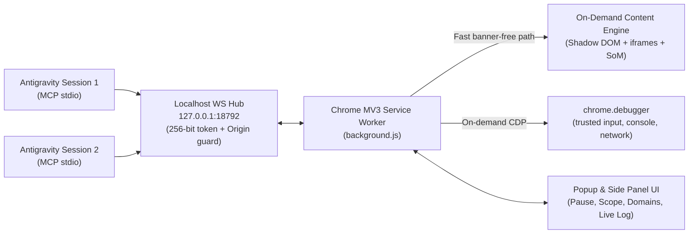

# Antigravity Chrome Connector

**Ultra-fast, banner-free Manifest V3 Chrome Extension + Shared Localhost Hub + MCP Server for Google Antigravity** (also compatible with Claude Code & Cursor).

Built from scratch to be faster, leaner on tokens, and more accurate on modern SPAs than standard remote-debugging or single-step browser connectors.

---

## Highlights (`v2.0.0`)

- **~1 ms local bridge, ~19 ms DOM snapshots, ~45 ms screenshots** — Content engine is injected on-demand only into target tabs (zero overhead on regular browsing) and keeps your MV3 service worker warm via 15s WebSocket heartbeats + `chrome.alarms` watchdog.
- **Zero Chrome Remote Debugging Flags or Re-Consent Popups** — No `--remote-debugging-port` launch hacks, no 60-second consent dialogs on restart, and no yellow Chrome debugger banner during normal browsing.
- **Cross-Frame `<iframe>` & Open Shadow DOM Support** — Automatically traverses open Shadow DOM and accessible subframes, indexing iframe controls cleanly as `[f<frameId>:<ref>]` so clicks, typing, hovers, and selects work inside embedded frames.
- **Modal-First + SPA-Aware + Occlusion-Aware Snapshots** — Surfaces `<dialog>` / `[aria-modal="true"]` overlays first, detects React/Vue `cursor: pointer` click targets without duplicate child noise, collapses repetitive links, and flags `(covered)` elements via `elementFromPoint` hit-testing.
- **70–90% Token Savings with Diff Snapshots (`diff: true`) & Instant `browser_find`** — Fetch only `+added`/`-removed` elements after SPA updates, or locate any control in `<5 ms` without dumping the full page.
- **Single-Round-Trip Batched Execution (`browser_batch`)** — Chain up to 30 steps (`type`, `click`, `hover`, `drag`, `select`, `press_key`, `scroll`, `wait`, `navigate`, `assert_text`, `assert_url`) + a compact final snapshot in **one** MCP tool call.
- **Set-of-Marks (SoM) Visual Screenshots (`annotate: true`)** — Temporarily draws numbered `[ref]` pills directly onto visible controls for visual/icon-heavy UIs and removes them immediately after capture.
- **On-Demand `chrome.debugger` (CDP) Elevation** — Pass `trusted: true` for hardware-level `event.isTrusted` clicks/keystrokes/smooth drags or CSP-free eval, or attach for live `browser_console`, `browser_network` (with response bodies), `fullPage: true` screenshots, and raw `browser_cdp` — then call `browser_cdp(action="detach_all")` to hide the banner.
- **Multi-Session Shared Localhost Hub** — Multiple concurrent Antigravity chats share one Chrome connection on `127.0.0.1:18792` with zero `EADDRINUSE` collisions.
- **Live Chrome Control UI (Toolbar Popup + Side Panel)** — Real-time action feed with latencies, one-click **Pause/Resume** kill switch, **Tab Scope** (`All Tabs` / `Group Only` / `Active Tab`), dedicated purple **Antigravity** Chrome tab group, **Protected Domains** denylist, and **Allow JS Eval** toggle.

---

## Comparison

| Capability | Standard CDP MCP | Typical Browser Connector | **Antigravity Chrome Connector** |
| :--- | :---: | :---: | :---: |
| Works on your real logged-in Chrome profile | Requires remote debug toggle | Yes | **Yes (zero flags)** |
| Banner-free normal browsing & screenshots | No (always shows banner) | Partial | **Yes (CDP on-demand only)** |
| Multiple concurrent agent sessions | No (port lock) | Limited | **Yes (shared loopback Hub)** |
| Multi-step single round-trip (`browser_batch`) | No | Limited | **Yes (up to 30 steps + assertions)** |
| Diff snapshots (`diff: true`) | No | No | **Yes (70–90% fewer tokens)** |
| Set-of-Marks annotated screenshots (`annotate: true`) | No | Rare | **Yes (auto-cleaned overlay + legend)** |
| Cross-frame `<iframe>` + Shadow DOM refs | Partial | Partial | **Yes (`[f<id>:<ref>]`)** |
| Live Side Panel kill switch + Protected Domains | No | Partial | **Yes** |

---

## Architecture



---

## 60-Second Quickstart

```bash
git clone https://github.com/TPZZ759/antigravity-chrome-connector.git
cd antigravity-chrome-connector
npm install
npm run setup
```

`npm run setup` automatically:
1. Generates a unique 256-bit auth token in `~/.antigravity-chrome/config.json` and writes the gitignored `extension/bridge.config.json`.
2. Generates the extension icons (`16`/`32`/`48`/`128`px).
3. Registers `antigravity-chrome` in Antigravity's `~/.gemini/config/mcp_config.json` (use `--client claude` or `--client cursor` for other agents).
4. Installs the companion Antigravity skill to `~/.gemini/config/skills/antigravity-chrome/SKILL.md`.

Then load the extension once in Chrome:
1. Open **`chrome://extensions`** and enable **Developer mode** (top right).
2. Click **Load unpacked** and select the `extension/` folder inside this repo.
3. Pin **Antigravity Chrome Connector** to your toolbar and refresh MCP servers in Antigravity — the badge turns green **`ON`** automatically.

---

## MCP Tool Catalog (21 Tools)

| Category | Tools |
| :--- | :--- |
| **Session & Tabs** | `browser_status`, `browser_tabs`, `browser_navigate` |
| **Reading & Discovery** | `browser_snapshot` (`diff`, `includeFrames`, `viewportOnly`), `browser_find`, `browser_read_page` (`text`/`links`/`tables`/`forms`/`html`), `browser_screenshot` (`annotate` SoM / `fullPage`) |
| **Interaction** | `browser_click`, `browser_hover`, `browser_drag`, `browser_type`, `browser_select`, `browser_press_key`, `browser_scroll`, `browser_wait`, `browser_batch` |
| **Inspection & On-Demand CDP** | `browser_eval`, `browser_storage`, `browser_console`, `browser_network`, `browser_cdp` (`send`/`detach`/`detach_all`) |

---

## Security Model

- **Loopback-only binding:** The Hub binds strictly to `127.0.0.1` (never exposed to LAN).
- **256-bit shared token:** Stored locally in `~/.antigravity-chrome/config.json` (mode `0600`) and verified with `crypto.timingSafeEqual`. `extension/bridge.config.json` is strictly `.gitignore`d and never committed.
- **Anti-CSWSH Origin check:** WebSocket upgrades from `http://` or `https://` web pages are rejected with HTTP `403 Forbidden`.
- **User-in-the-loop guardrails:** Instant **Pause** kill switch, **Group Only** / **Active Tab** isolation, **Protected Domains** denylist, and toggleable **Allow JS Eval**.

---

## Verification

```bash
npm run verify
```

Runs syntax checks, MV3 manifest + icon checks, `.gitignore` secret hygiene checks, live Hub security tests (HTTP `403` on untrusted web `Origin`, HTTP `401` on invalid token), and two concurrent MCP stdio clients executing parallel tool calls (including iframe refs) through the Hub.

## License

[MIT](LICENSE)
